# Noise-Robust Path Tracking for an Autonomous Mini-Drone

Classical DSP (no AI/ML) for camera, IMU and altitude signals: DSP course project ("Digital Signal Processing in Today's Era", VJTI) and MathWorks Minidrone Competition India 2026 entry.

**Live demo:** open the GitHub Pages link on a phone and tap *Phone camera* or *Start phone sensors* to run the pipeline on the phone's real camera, accelerometer and gyroscope.

| Path | Chain |
|---|---|
| Vision | Median 3×3 → RGB→HSV threshold (tap-to-pick colour) → close/open (3×3 close for thin cables) → bottom-½ ROI → biggest blob → edges → Hough → least-squares refine → low-pass → PID |
| Inertial | FFT peak search → auto notch → low-pass → atan2 roll → complementary / Kalman fusion with gyro |
| Altitude | Median → moving average / 1D Kalman |

## Block diagram

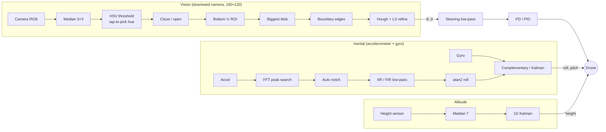

## Screenshots

**Real-camera vision fix**: same frame (warm wooden floor, hand, red clutter, 2 px red cable; true angle 7.1°), before and after:

| Before: fixed red range, 5×5 opening, whole-frame Hough → −12° | After: tapped colour, thin-line close, ROI + biggest blob → 7.1° / 0.0 px |
|---|---|
| 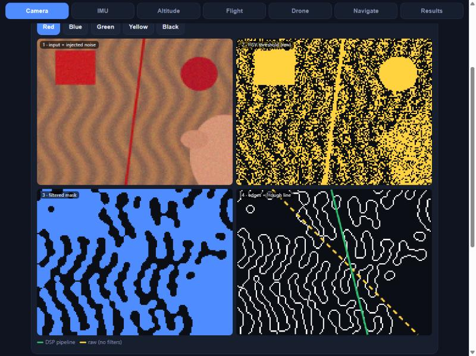 | 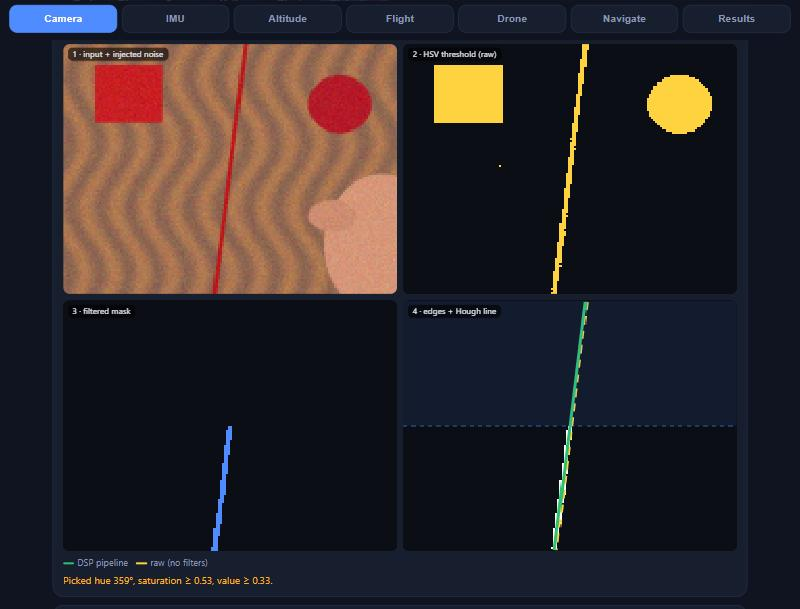 |

**MATLAB simulation** (`matlab/minidrone_dsp_sim.m`):

| | |
|---|---|
| 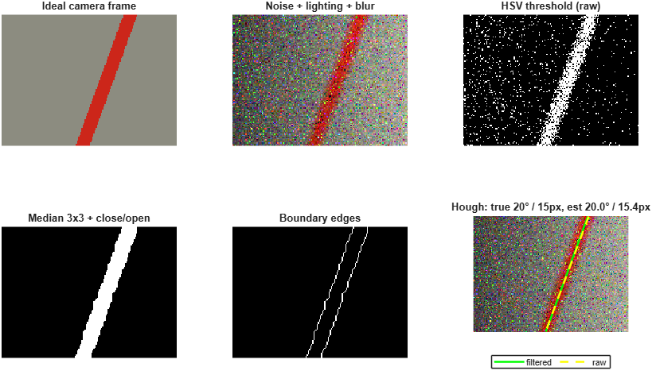 | 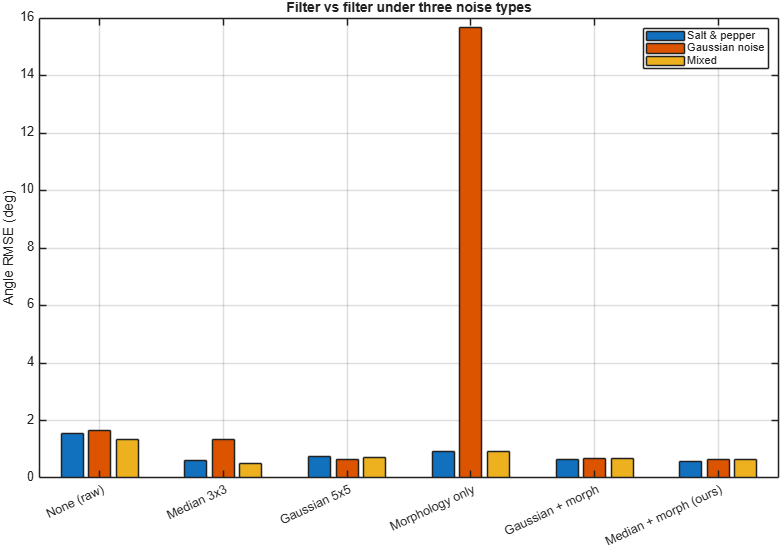 |
| 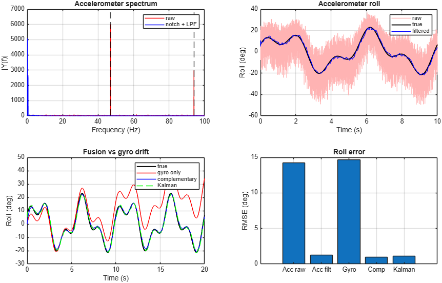 | 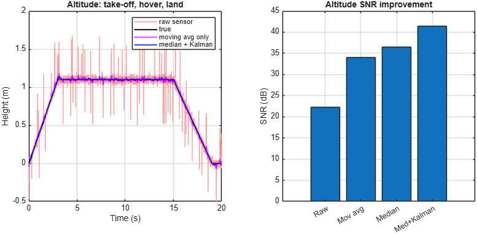 |
| 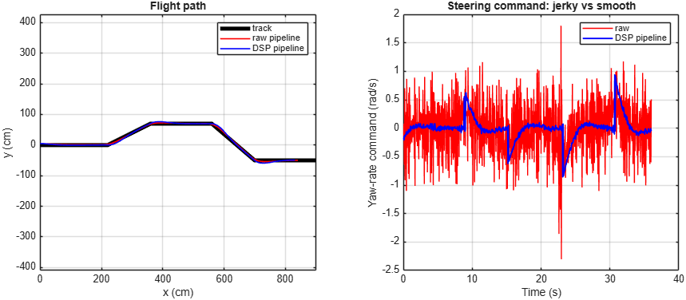 | 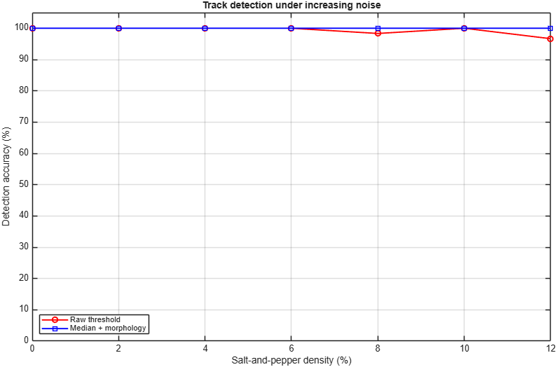 |

**ESP32 + MPU6050 rig analysis** (`matlab/esp32_mpu6050_analysis.m`). These figures come from the script's built-in *simulated* log until a real rig CSV is recorded:

| | |
|---|---|
| 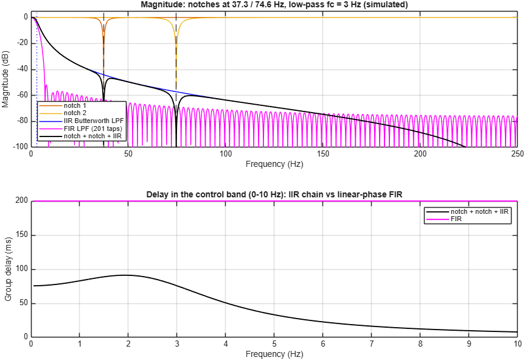 | 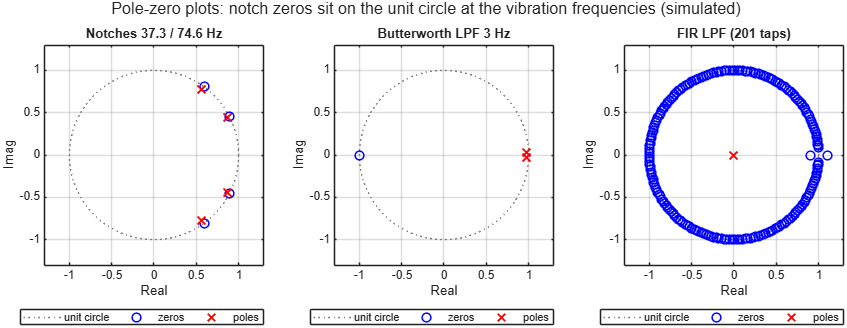 |
| 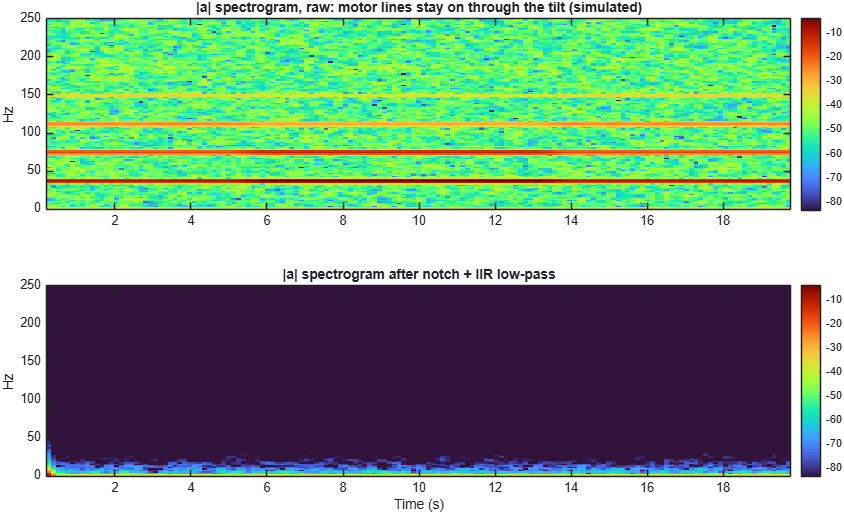 | 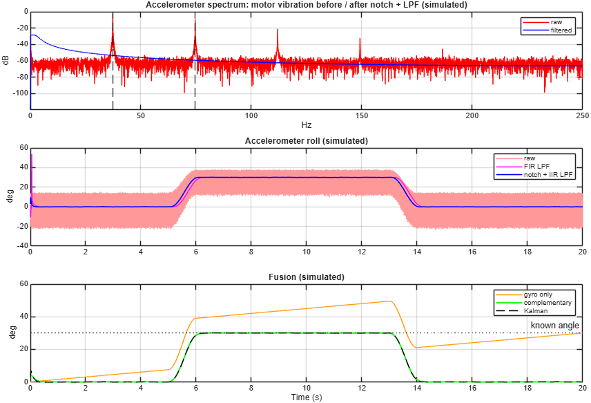 |

**Demo video**: _to add after recording: `docs/img/demo.gif` (about 10 s of the Camera tab on the real cable) and a link to the full video._

- `index.html`: the phone web app. Tabs:
  - **Camera / IMU / Altitude**: each path on its own, with filters you can switch off and sliders that inject noise
  - **Flight**: closed loop, comparing a raw drone and a DSP drone on the same noisy camera
  - **Drone**: camera and IMU together (track tracking plus an artificial horizon showing roll and pitch); hold the phone flat with the back camera facing down
  - **Navigate**: the phone locates itself with no extra hardware. Downward camera → Hann window → 2D FFT phase correlation (optical flow) → quality gate → median → low-pass, plus gyro heading with bias calibration and compass fusion. Shows a live map of a 150 × 100 cm arena with an obstacle, an A* route, arrow + voice directions, and raw vs filtered paths. Also has a simulation with ground truth and a 5-run drift test.
  - **Navigate with ESP32**: sources *Simulate ESP32* and *ESP32 via Bluetooth*. Anchors in the room corners give position through RSSI → median → Kalman → path-loss → trilateration → weighted least squares → position Kalman. The phone gives heading. A* route, arrow + voice. Room size and obstacles are set on the map. Firmware is in `hardware/esp32_beacon/`; filter switches + calibration are on the Beacon page (button in Navigate).
  - **Results**: runs every comparison from the proposal with a fixed seed (E1 filter vs filter, E2 accuracy vs noise, E3 FIR vs IIR, notch and fusion, E4 altitude, E5 flight), then Copy tables or Download CSV
  - Falls back to simulated sensors when the real ones are unavailable.
- `PLAN_A.md`: **the demo plan**. Three proofs matching proposal §4: Simulink minidrone, ESP32 + MPU6050 vibration rig, real track + landing pad.
- `hardware/esp32_mpu6050/`: 500 Hz MPU6050 streaming firmware (IMU tab → ESP32 + MPU6050 (USB)).
- `matlab/esp32_mpu6050_analysis.m`: FFT / notch / FIR vs IIR / fusion analysis of rig logs, plus frequency response, pole-zero and spectrogram plots. Uses the newest `mpu6050_log*.csv` in the folder; without one it runs on a labelled simulated log.
- `matlab/simulink/`: MATLAB Function blocks (toolbox-free, fixed-size, code-generation friendly), `test_simulink_blocks.m` to check them in plain MATLAB, and a guide for the parrotMinidroneCompetition model.
- `matlab/minidrone_dsp_sim.m`: the full simulation in MATLAB. Runs on plain MATLAB: the toolbox functions are written out as local functions.
- `test_images/real_floor.png`: a realistic test frame for the Camera tab's *Photo* source.
- `matlab/phone_sensor_demo.m`: the same pipeline on real phone data via MATLAB Mobile (`mobiledev`).

Team: Rayon Biswas, Zaid Faruqui, Tanisha Nevrekar, Piyush Patil, Ananya Rane, Arpit Rajput.
