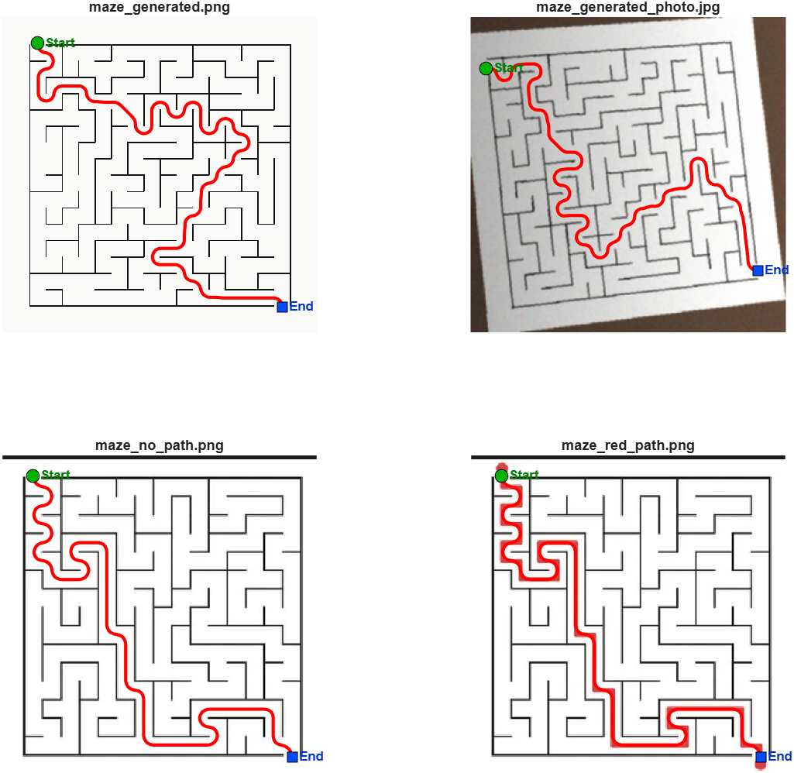

# Maze Solver

**MATLAB implementation of the maze-solving task: shortest path from a single image of a maze.**

This is a standalone MATLAB counterpart to the app's **Navigate → Maze** feature. It follows the same method, is evaluated on the repository's [`test_images/`](../test_images/), and is checked against a known solution.

| | |
|---|---|
| **Language** | MATLAB (no toolboxes required) |
| **Input** | Image of a maze (PNG or JPG; scanned, generated or photographed) |
| **Output** | Shortest route drawn in red, with Start and End marked |
| **Result** | 4 / 4 test mazes solved; 100 % agreement with the reference solution |

---

## Method

| Stage | Description |
|---|---|
| **1. Wall detection** | Pixels that are dark in every colour channel are classified as walls, using an Otsu threshold. Coloured markings (e.g. a red line drawn on the maze) are therefore not treated as walls. |
| **2. Clean-up** | Walls are dilated slightly to close small breaks. Dark regions touching the image border (background, black bars) are discarded. |
| **3. Maze boundary** | The convex hull of all wall segments defines the maze area. |
| **4. Entrance and exit** | The two largest openings in the outer wall are taken as the entrance and exit. |
| **5. Path planning** | Dijkstra's algorithm on the 8-connected pixel grid. Each pixel is weighted by its distance to the nearest wall, so the route follows the centre of the corridors. |

---

## Results

| Test image | Description | Solved | Runtime |
|---|---|:---:|---:|
| `maze_generated.png` | Computer-generated maze | ✓ | 1.9 s |
| `maze_generated_photo.jpg` | Photographed maze, tilted, on a dark background | ✓ | 2.7 s |
| `maze_no_path.png` | Scanned maze | ✓ | 0.6 s |
| `maze_red_path.png` | Same maze with the solution drawn in red | ✓ | 0.4 s |

### Validation

`maze_no_path.png` and `maze_red_path.png` show the same maze; the latter includes the correct route as a reference. **100 %** of the path computed for `maze_no_path.png` lies within 6 px of the reference route.

These results support the figure reported in the main README: *true shortest path found in 4 / 4 test mazes*.

---

## Usage

1. Open MATLAB in the repository root or in this folder.
2. Open `maze_solver.m` and click **Run**.

The script locates `test_images/` automatically, solves each maze, displays the results, and prints a summary including the validation check.

---

## Files

| File | Description |
|---|---|
| `maze_solver.m` | MATLAB implementation |
| `results/maze_results.png` | Computed paths on the four test mazes |
| `results/console_output.txt` | Start and end points, path length, runtime and validation result |
