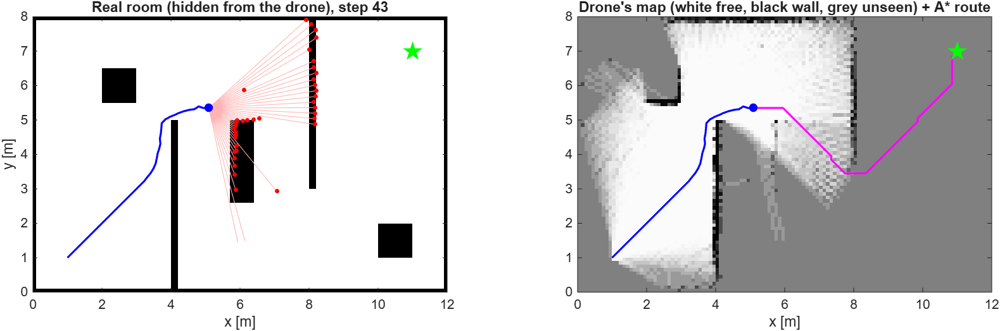
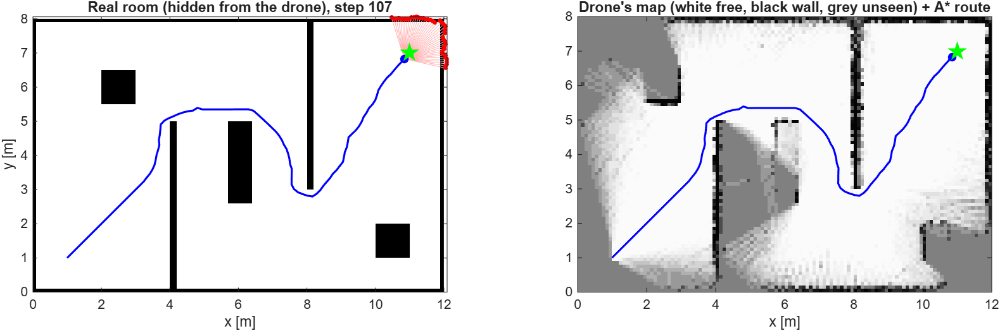
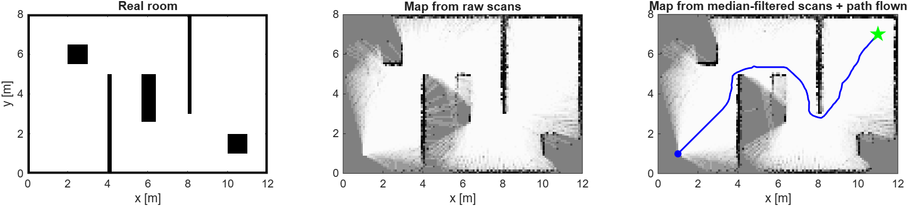

# Occupancy Grid Mapping and A* Route Planning.

A MATLAB simulation of the **Explore** mode from the mini-drone project: a drone explores a room it has never seen, builds a map from a noisy range sensor, and plans a safe route to a goal.

## Overview

The phone app's Explore mode builds an **occupancy grid** from a virtual laser scan and plans routes with **A\***. This simulation reproduces that pipeline in MATLAB and measures how much a **median filter** improves the noisy sensor readings.

At every step the drone:

1. **Senses**: takes a 41-beam range scan with noise and random bad readings
2. **Filters**: cleans the scan with a 3-tap median filter
3. **Maps**: updates a log-odds occupancy grid (white = free, black = wall, grey = unseen)
4. **Plans**: finds the shortest safe route to the goal with A\*
5. **Moves**: takes a small step along the route, re-planning if it is blocked

Partway through, a new obstacle appears in the drone's way to test re-planning.

## Results

**Re-planning around a new obstacle (step 43)**

**Goal reached (step 107)**

**Final maps: real room, raw scans, median-filtered scans**

| | Raw scans | Median-filtered |
|---|---:|---:|
| Range error per scan | 0.133 m | **0.056 m** |
| False obstacles in map | 10 | **5** |
| Map accuracy | 98.6 % | **98.8 %** |

- The drone reached the goal with **0 collisions**, re-planning around the new obstacle.
- The median filter **more than halves the sensor error** and the number of false obstacles.

## Files

| File | Description |
|---|---|
| `results/mid_run.png` | New obstacle appears and the route is re-planned |
| `results/live_view.png` | Goal reached, with the path flown and the drone's map |
| `results/final_maps.png` | Real room vs. maps from raw and filtered scans |
| `results/console_output.txt` | Event log of the run |
